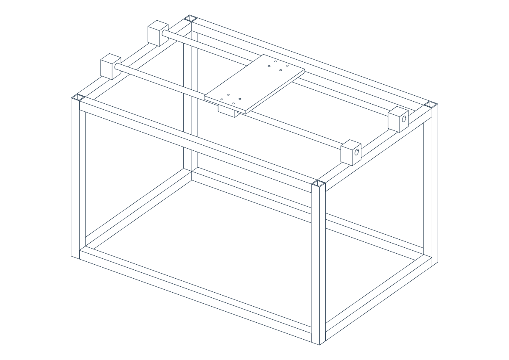

# M01 Gantry CAD Study

This folder preserves the parametric M01 pilot previously used by
`machine-cad-agent`. It belongs with the original Blender machine concepts in
this repository. It is a personal hobby and learning project developed with
AI assistance, and has not been fabricated or physically tested.

The model is a new layout study, rather than a converted Blender file:
21 named nominal solids comprising a hollow frame, rails, supports, sliding
blocks and carriage plate. It is not a complete diaper-changing machine.



## Run from this folder

Prerequisite: Docker with Compose v2 running.

```powershell
.\run.ps1
.\run.ps1 test
```

On macOS/Linux use `./run.sh` and `./run.sh test`. The local viewer is at
**http://127.0.0.1:8766**. Its distinct Compose project/image and host port can
coexist with the generic CAD agent. The demo produces `pass / fail / pass` by
introducing excessive carriage travel and restoring the baseline. Failed
builds preserve diagnostic PNG/GLB output while withholding STEP/STL.

Python source in `src/machine_cad/` and `configs/m01.json` are authoritative.
Generated files remain under ignored `builds/`. Per-build overrides leave the
canonical defaults unchanged. Reports preserve actual solid measurements,
sampled motion checks and source/input provenance.

## Optional MCP registration

```powershell
.\scripts\register-codex.ps1
```

This registers `diaper_m01_cad` for a fresh trusted Codex session in this folder.
It does not replace `machine_cad_agent`. Other MCP clients can use:

```text
docker compose --project-directory /absolute/path/to/diaper-changing-machines/cad-studies/m01-gantry -f /absolute/path/to/diaper-changing-machines/cad-studies/m01-gantry/compose.yaml run --rm -T dev python -m machine_cad.mcp_server
```

The preserved tools expose defaults, builds, checks, measurements, native PNGs
and gated export lists. The server needs no API key; the client supplies its
LLM/VLM. Dependencies include CadQuery/Open CASCADE, the MCP Python SDK,
CairoSVG and Google's model-viewer. Licenses are retained in this folder.

The nine digital tests cover valid solids, plate dimensions/holes, rail gaps,
travel bounds, real collisions, STEP roundtrip, invalid parameters, export
gating and real MCP stdio. The nested workflow file is historical source,
and does not run as a root workflow in this repository.

[Validation record](docs/VALIDATION.md) preserves evidence from the previous
location. Those CI URLs and machine-specific hashes are historical. A passing
report establishes its stated geometry checks, with no strength, control,
hygiene or child-use qualification.
